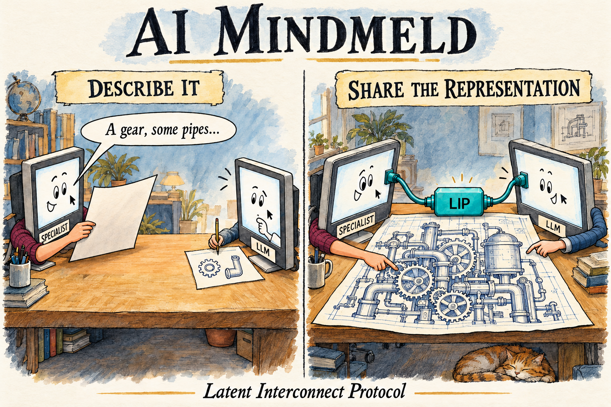
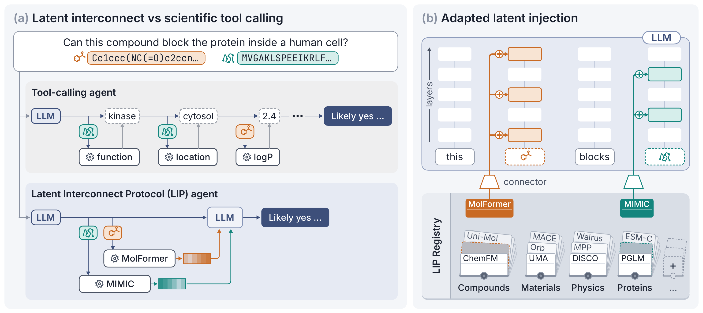

<p align="center">
  
</p>

<p align="center"><strong>A Latent Interconnect Protocol</strong></p>
<p align="center">Data · Training · Evaluation · Inference</p>
<p align="center"><a href="https://polymathic-ai.org/blog/ai-mindmeld/">Blog post</a> · <a href="https://arxiv.org/abs/2610.30215">Paper</a> · <a href="https://huggingface.co/sgolkar/ai-mindmeld-connectors">Connectors</a> · <a href="https://huggingface.co/datasets/sgolkar/ai-mindmeld-data">Data</a></p>

---



Frontier LLMs make powerful agents, but communication with other models hits a bottleneck: rich, high-dimensional
representations must be translated into human-understandable forms. AI Mindmeld connects their representations
directly, opening up information an agent may never know to ask for. However, training frontier LLMs is expensive,
and new ones keep arriving.
Asking every specialist team to fine-tune its own LLM won't scale. A community protocol needs **flexibility** for new questions, **extensibility** for
new models, and **compositionality** to use them together.

The **Latent Interconnect Protocol (LIP)** connects scientific specialist models to a shared receiving LLM through
small, independently trained connectors. Each connector maps a specialist's representation of an object
into the LLM's hidden states at a slot in the prompt. Both models stay frozen. The same connector supports
new questions, and independently trained connectors can be combined in one prompt.

[](assets/figure-1.pdf)

*Figure 1. LIP alongside tool calling. Specialist representations enter the LLM through learned connectors;
several specialists can contribute to the same question. One agent can use both routes.*

## What you can do

- **Ask about an object.** Supply a protein sequence or a stored molecule embedding, then ask about
  properties and function, including question types beyond connector training. The
  [Quickstart](examples/README.md) covers stored ChemFM vectors and embedding your own proteins.
- **Combine specialists.** Bring a protein and a molecule into one question, or combine several specialists'
  views of the same object. The connectors are trained independently, with no joint training for the combination.
- **Add a specialist affordably.** Train a connector in roughly **3–4 hours on one GPU for Gemma**. For
  **Kimi K2.6**, our optimized training code (expert parallelism adapted from
  [Trellis](https://www.workshoplabs.ai/blog/post-training-50x-faster) and fused Triton kernels) brings this
  **under 4 hours on one 8×H200 node**.

Our experiments connect protein specialists (ESM-C, MIMIC, and PGLM) and molecule specialists (ChemFM,
MoLFormer, and Uni-Mol2) to **Gemma 3 4B**, **Gemma 3 12B**, and **Kimi K2.6**. Each connector is specific to
its specialist, extraction recipe, and LLM.

## LIP library

Browse the **[LIP library](library/README.md)** for connector descriptions, training data, injection layouts,
and download availability. Community connectors are hosted by their authors; follow the
[submission protocol](CONTRIBUTING.md#list-your-connector) to add yours to the directory.

To build one, see [Extending the package](examples/guides/extending.md) and
[Packaging and sharing a connector](examples/guides/contributing-a-connector.md).

## Full release: data and code

The release covers the complete workflow: **data, connector code, training code, evaluation code, and inference code**.

| Component | Scope |
|---|---|
| **Data** | Data preparation, processed annotations, splits, and training and evaluation sets. |
| **Connectors** | Code for eight specialists: **PGLM-1B, MIMIC, ESM-C 600M, ESM-C 6B, ChemFM-1B, ChemFM-3B, MoLFormer-c3, and Uni-Mol2 1.1B**. |
| **Training** | Specialist embedding extraction, initial alignment, layer selection, and connector training. |
| **Evaluation** | Within-task generalization, transfer to new questions, composition, and the analyses behind the paper's results. |
| **Inference** | Loading trained connectors, asking questions about new objects, combining specialists, and interactive chat. |

## Quickstart

Follow the [Quickstart](examples/README.md) to install AI Mindmeld and ask your first question with
**Gemma 3 4B and ESM-C 600M or ChemFM-1B**. Accept Gemma's model terms before downloading its weights.
The guide covers resource requirements, a small evaluation, raw protein input, two DEMO non-linear
connectors, and a short CPU training run.

## Examples and guides

Browse **[Examples and guides](examples/docs/README.md)** for chat and connector development, including
a [getting-started guide](examples/README.md). Use [Interactive chat (web GUI)](examples/guides/chat.md)
for browser chat and the HTTP API, or the [Chat CLI demo](examples/demos/README.md) to send these editable
requests to a running server:

| Demo | Input | Question |
|---|---|---|
| [Protein](examples/demos/requests/protein.json) | A protein sequence through ESM-C 600M | What is this protein's likely molecular function? |
| [Molecule](examples/demos/requests/molecule.json) | A SMILES string through ChemFM-1B | What functional groups does this molecule contain? |
| [Composition](examples/demos/requests/composition.json) | A protein and molecule (a SMILES) through separate connectors | Could this molecule inhibit this protein? What mechanism would explain it? |

Live demo requests need a chat server configured with the matching LLM, connectors, and specialist
encoders. For molecule questions using stored ChemFM vectors, start with [Quickstart step 4](examples/README.md#4-ask-a-question).

The client uses only Python's standard library (Python 3.11 or newer). Preview a request without a model or GPU:

```bash
python examples/demos/chat.py examples/demos/requests/composition.json --show-request
```

For live requests, server selection, authentication, and transcripts, see the [Chat CLI demo](examples/demos/README.md).

## Limitations

The LLMs were not pretrained to receive specialist representations and often interpret an injected slot
as an object name. Extended reasoning and conversation can degrade performance compared with asking for
a direct answer.

For best results, pose a focused question and read the model's probabilities for the relevant answer
tokens. The library's AUROCs use `log P(Yes) − log P(No)` from direct yes/no questions;
`examples/ask.py --yes-no` prints these probabilities and that score for one object
([getting started](examples/README.md#4-ask-a-question)).

For the measured effect of reasoning on protein-property prediction, see the [paper's](https://arxiv.org/abs/2610.30215) **LLM responses to
latent inputs and the effect of reasoning** section. Its **Limitations** paragraph in **Discussion and
outlook** covers the broader limits of the approach. The [LIP library](library/README.md#uploaded-connectors)
explains how to interpret connector scores; the paper describes connector training and held-out-task design.

## Models and licensing

Our code is [Apache-2.0](LICENSE). Our connector weights, two minimal evaluation sets, and ridge starts are
[CC BY 4.0](LICENSE-ARTIFACTS.md); [upstream and non-commercial terms](LICENSE-ARTIFACTS.md#non-commercial-items)
apply separately.

## Citation

Please cite the paper first, then the repository:

> Siavash Golkar, Jake Kovalic, and Shirley Ho. *[AI Mindmeld: A Latent Interconnect Protocol.](https://arxiv.org/abs/2610.30215)* arXiv:2610.30215, 2026.
>
> Siavash Golkar, Dennis Bollweg, and the AI Mindmeld contributors. *AI Mindmeld* [software repository](https://github.com/PolymathicAI/AI-Mindmeld).

Include the software revision you used. [CITATION.cff](CITATION.cff) provides machine-readable citations;
[NOTICE](NOTICE) records the attribution notice.

BibTeX:

```bibtex
@misc{golkar2026aimindmeldlatentinterconnect,
      title={AI Mindmeld: A Latent Interconnect Protocol},
      author={Siavash Golkar and Jake Kovalic and Shirley Ho},
      year={2026},
      eprint={2610.30215},
      archivePrefix={arXiv},
      primaryClass={cs.LG},
      url={https://arxiv.org/abs/2610.30215},
}
```
